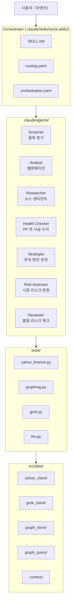

# Architecture

## System Overview

자연어 퍼스트 투자 분석 시스템. Agentic AI Pattern 으로 설계.
사용자는 한국어로 의도를 전달하기만 하면, 오케스트레이터가 적절한 에이전트를 자율적으로 선택·기동한다.
기준 시장은 한국(KOSPI/KOSDAQ), 보조 시장은 미국, 기준 통화는 KRW 다.

Claude Code Skills 로 동작하며, Yahoo Finance API (yfinance) + Grok API (X/Web 검색) + Neo4j (GraphRAG) + 멀티 LLM (Gemini/GPT/Grok) 을 통합한다.

---

## Layer Architecture



---

## Data Flow

```
1. 사용자 발화（자연어）
   ↓
2. Orchestrator (SKILL.md)
   ├─ routing.yaml 로 의도→에이전트 판정
   ├─ 기록계（메모·매매 기록）→ 직접 실행（action: direct）
   └─ 분석계 → 에이전트를 서브에이전트로 기동
   ↓
3. Agent (agent.md + examples.yaml)
   ├─ GraphRAG 로 과거 컨텍스트 취득
   ├─ tools/ 경유로 데이터 취득
   ├─ 자율적으로 판단·계산·정형화
   └─ 투자 판단을 동반하는 출력 → Reviewer 를 자동 삽입
   ↓
4. Tools (tools/*.py)
   ├─ yahoo_finance: yfinance + 24h JSON cache
   ├─ graphrag: Neo4j GraphRAG (dual-write)
   ├─ grok: Grok API (X/Web 검색)
   └─ llm: Gemini/GPT/Grok (멀티 LLM 리뷰)
   ↓
5. 결과 표시 + GraphRAG 에 자동 축적
   ↓
6. Orchestration (orchestration.yaml)
   ├─ 0건 → 조건 완화 후 재시도
   ├─ Reviewer FAIL → 반려
   └─ 상한 도달 → 현재 결과 제시
```

---

## Design Principles

### 1. Natural Language First
사용자 인터페이스는 자연어. `routing.yaml` 이 모든 입구. 에이전트가 자율적으로 파라미터를 결정한다.

### 2. Agentic AI Pattern
- **Orchestrator** (SKILL.md): 어떤 에이전트를 부를지
- **Agents** (agent.md): 판단·계산·정형화를 자율 실행
- **Tools** (tools/): 데이터 취득만. 판단하지 않음
- **Few-shot** (examples.yaml): 에이전트의 행동을 샘플로 제시

### 3. Dual-Write Pattern (JSON master + Neo4j view)
- JSON 파일이 master 데이터 소스（항상 쓰기 성공）
- Neo4j 는 view（검색·연관용）. try/except 로 graceful degradation
- Neo4j 가 죽어도 모든 기능이 동작한다

### 4. Multi-LLM Review & DeepThink 4-Swarm
Reviewer 에이전트가 3개의 LLM（GPT/Gemini/Claude）을 병렬로 기동해 서로 다른 관점에서 리뷰한다. API 키 미설정 시에는 전부 Claude 로 실행（graceful degradation）.

DeepThink 모드에서는 **2층 모델의 4-Swarm** 으로 평가:
- **인프라층（고정）**: Grok=X/실시간 시장 데이터, Gemini=Google 검색+롱 컨텍스트（하드 제약: 다른 LLM 으로 대체 불가）
- **추론층（동적）**: Devil's Advocate / Scenario Analyst / Lesson Auditor / Portfolio Aligner 를 테마에 따라 GPT/Gemini/Grok/Claude 에 할당
- Claude 자신도 오케스트레이터 층에서 추론에 참여（Agent 기동 불필요）

### 5. Self-Healing Orchestration
orchestration.yaml 에 기반한 자율 수정 루프. 스크리닝 0건→조건 완화, Reviewer FAIL→반려. 사용자에게 묻는 것은 매매의 최종 실행뿐이다.

---

## Agent Summary

| 에이전트 | 역할 | 사용 툴 | 기본 LLM |
|:---|:---|:---|:---|
| Screener | 종목 찾기·스크리닝 | yahoo_finance | Claude |
| Analyst | 밸류에이션·저평가 판정 | yahoo_finance, graphrag | Claude |
| Researcher | 뉴스·센티먼트·업계 동향 | grok, graphrag | Grok |
| Health Checker | PF 의 사실·수치（판단하지 않음） | yahoo_finance, graphrag | Claude |
| Strategist | 투자 판단·추천 | yahoo_finance, graphrag | Claude |
| Risk Assessor | 시장 리스크 판정（risk-on/neutral/risk-off） | yahoo_finance, WebSearch | Claude |
| Reviewer | 품질·모순·리스크 체크 | llm, graphrag | GPT+Gemini+Claude |

## Tool Summary

| 툴 | 소스 | 역할 |
|:---|:---|:---|
| yahoo_finance.py | src/data/yahoo_client/ | 주가·펀더멘털·스크리닝 |
| graphrag.py | src/data/graph_store/ + graph_query/ | Neo4j 지식 그래프 |
| grok.py | src/data/grok_client/ | Grok API（X/Web 검색） |
| llm.py | (직접 API 호출) | Gemini/GPT/Grok 멀티 LLM |

## Testing & Worktree Tooling（KIK-745/746/747）

클린 환경（API key 없음·개인 PF 없음）에서도 통합 시험을 돌릴 수 있는 다층 구성:

```
[Layer A] Unit Tests (약 1,400건, autouse mock)
  python3 -m pytest tests/ -q
  → tests/conftest.py:_block_external_io 가 Neo4j/TEI/Grok 을 전부 자동 모킹

[Layer B] Dry-run (KIK-746, < 1초)
  python3 tests/e2e/run_e2e.py --dry-run
  → src/orchestrator/dry_run.py 로 routing.yaml 정합성 + agent 정의 존재 확인
  → LLM/Yahoo Finance 일절 호출하지 않음, API key 불필요

[Layer C] Mocked E2E (KIK-747, < 1초)
  python3 -m pytest tests/e2e/test_mocked.py -q
  → pytest fixture 로 tools/llm.py / tools/yahoo_finance.py / tools/grok.py 를 stub
  → agent.md / examples.yaml 은 실물을 사용, 외부 I/O 만 교체

[Layer D] Real-API E2E (API key 필요, ~25초)
  python3 tests/e2e/run_e2e.py
  → 실제 Yahoo Finance / 실제 LLM 을 호출하는 최종 검증
```

### Worktree 플로우（KIK-745）

```
scripts/setup_worktree.sh KIK-NNN feature-name
  ├─ git worktree add -b feature/kik-NNN-feature-name ~/stock-skills-kikNNN
  ├─ tests/fixtures/sample_portfolio.csv → ~/stock-skills-kikNNN/data/portfolio.csv
  └─ tests/fixtures/sample_cash_balance.json → ~/stock-skills-kikNNN/data/cash_balance.json

⚠ 개인 PF（~/stock-skills/data/portfolio.csv）를 worktree 에 cp 하는 것은 금지.
   실수로 커밋해 개인 종목이 유출되는 것을 막기 위해 범용 테스트 종목만 사용한다.
```
