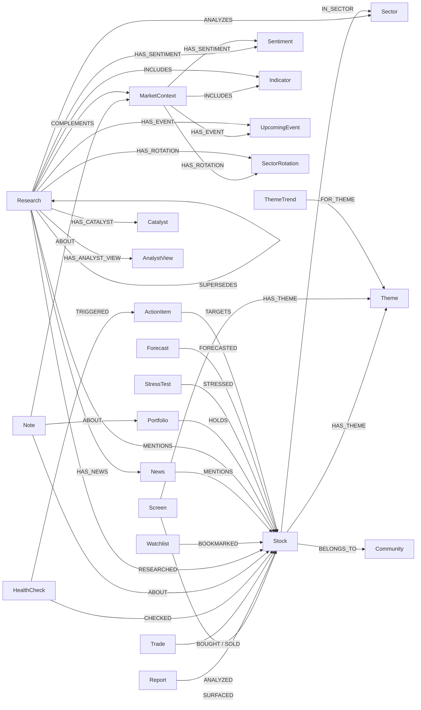

# Neo4j Knowledge Graph Schema

> **ℹ️ Neo4j 는 옵션 기능이다（KIK-719）**
> 신규 사용은 `data/` 로컬 스토리지만으로 완결된다. Neo4j 는 기존 사용자를 위해 지원을 계속한다.
> Neo4j 미접속 시에는 `src/data/context/fallback_context.py` 가 로컬 파일（notes/portfolio/screening_results）에서 자동 컨텍스트를 조립한다.

투자 지식 그래프의 스키마 레퍼런스. `src/data/graph_store/` 가 정의·관리한다.

---

## Node Types (24)

### Stock
중심 노드. 모든 액티비티가 이 노드에 연결된다.

| Property | Type | Description |
|:---|:---|:---|
| symbol | string (UNIQUE) | 티커 심볼 (e.g. 005930.KS, 247540.KQ, AAPL) |
| name | string | 종목명 |
| sector | string | 섹터 |
| country | string | 국가 |

### Screen
스크리닝 실행 결과.

| Property | Type | Description |
|:---|:---|:---|
| id | string (UNIQUE) | `screen_{date}_{region}_{preset}` |
| date | string | 실행일 (YYYY-MM-DD) |
| preset | string | 프리셋명 (alpha, value, etc.) |
| region | string | 지역 (kr, us) |
| count | int | 히트 건수 |

### Report
개별 종목 리포트. full 모드에서는 확장 프로퍼티 있음.

| Property | Type | Description |
|:---|:---|:---|
| id | string (UNIQUE) | `report_{date}_{symbol}` |
| date | string | 실행일 |
| symbol | string | 대상 종목 |
| score | float | 밸류 스코어 (0-100) |
| verdict | string | 판정 (저평가/적정/고평가) |
| price | float | 주가 (full 모드만) |
| per | float | PER (full 모드만) |
| pbr | float | PBR (full 모드만) |
| dividend_yield | float | 배당수익률 (full 모드만) |
| roe | float | ROE (full 모드만) |
| market_cap | float | 시가총액 (full 모드만) |

### Trade
매매 기록.

| Property | Type | Description |
|:---|:---|:---|
| id | string (UNIQUE) | `trade_{date}_{type}_{symbol}` |
| date | string | 거래일 |
| type | string | buy / sell |
| symbol | string | 종목 |
| shares | int | 주수 (1주 단위) |
| price | float | 거래 가격 |
| currency | string | 통화 (KRW/USD, 기본값 KRW) |
| memo | string | 메모 |

### HealthCheck
헬스체크 실행 결과.

| Property | Type | Description |
|:---|:---|:---|
| id | string (UNIQUE) | `health_{date}` |
| date | string | 실행일 |
| total | int | 체크 대상 수 |
| healthy | int | 건전 종목 수 |
| exit_count | int | EXIT 판정 수 |

### Note
투자 메모.

| Property | Type | Description |
|:---|:---|:---|
| id | string (UNIQUE) | UUID |
| date | string | 작성일 |
| type | string | thesis/observation/concern/review/target/lesson/journal |
| content | string | 메모 내용 |
| source | string | 정보 소스 |
| category | string | 카테고리 (stock/portfolio/market/general) (KIK-473) |

### Theme
종목에 붙인 테마 태그.

| Property | Type | Description |
|:---|:---|:---|
| name | string (UNIQUE) | 테마명 (e.g. AI, EV, 반도체) |

### Sector
섹터 분류.

| Property | Type | Description |
|:---|:---|:---|
| name | string (UNIQUE) | 섹터명 (e.g. Technology, Healthcare) |

### Research
심층 리서치 결과.

| Property | Type | Description |
|:---|:---|:---|
| id | string (UNIQUE) | `research_{date}_{type}_{target}` |
| date | string | 실행일 |
| research_type | string | stock/industry/market/business |
| target | string | 대상 (종목/업계명/시장명) |
| summary | string | 요약 |

### Watchlist
워치리스트.

| Property | Type | Description |
|:---|:---|:---|
| name | string (UNIQUE) | 리스트명 |

### MarketContext
시황 스냅숏.

| Property | Type | Description |
|:---|:---|:---|
| id | string (UNIQUE) | `market_context_{date}` |
| date | string | 취득일 |
| indices | string (JSON) | 지수 데이터 (JSON 문자열) |

### News (KIK-413 full mode)
뉴스 기사. Research 에서 HAS_NEWS 로 연결.

| Property | Type | Description |
|:---|:---|:---|
| id | string (UNIQUE) | `{research_id}_news_{i}` |
| date | string | 기록일 |
| title | string | 헤드라인 (최대 500자) |
| source | string | 소스 (grok/yahoo/언론사명) |
| link | string | URL |

### Sentiment (KIK-413 full mode)
센티먼트 분석 결과. Research/MarketContext 에서 HAS_SENTIMENT 로 연결.

| Property | Type | Description |
|:---|:---|:---|
| id | string (UNIQUE) | `{parent_id}_sent_{source}` |
| date | string | 기록일 |
| source | string | grok_x / yahoo_x / market |
| score | float | 스코어 (0.0-1.0) |
| summary | string | 요약 |
| positive | string | 긍정 요인 (yahoo_x 만) |
| negative | string | 부정 요인 (yahoo_x 만) |

### Catalyst (KIK-413 full mode, KIK-430 확장)
호재·악재. Research 에서 HAS_CATALYST 로 연결.
stock/business: positive/negative. industry: trend/growth_driver/risk/regulatory.

| Property | Type | Description |
|:---|:---|:---|
| id | string (UNIQUE) | `{research_id}_cat_{type}_{i}` |
| date | string | 기록일 |
| type | string | positive / negative / trend / growth_driver / risk / regulatory |
| text | string | 내용 (최대 500자) |

### AnalystView (KIK-413 full mode)
애널리스트 견해. Research 에서 HAS_ANALYST_VIEW 로 연결.

| Property | Type | Description |
|:---|:---|:---|
| id | string (UNIQUE) | `{research_id}_av_{i}` |
| date | string | 기록일 |
| text | string | 견해 텍스트 (최대 500자) |

### Indicator (KIK-413 full mode, KIK-430 확장)
매크로 지표 스냅숏. MarketContext/Research(market) 에서 INCLUDES 로 연결.

| Property | Type | Description |
|:---|:---|:---|
| id | string (UNIQUE) | `{context_id}_ind_{i}` |
| date | string | 기록일 |
| name | string | 지표명 (e.g. S&P500, KOSPI, USD/KRW) |
| symbol | string | 심볼 (e.g. ^GSPC, ^KS11, KRW=X) |
| price | float | 값 |
| daily_change | float | 일간 변화율 |
| weekly_change | float | 주간 변화율 |

### UpcomingEvent (KIK-413 full mode)
향후 이벤트. MarketContext 에서 HAS_EVENT 로 연결.

| Property | Type | Description |
|:---|:---|:---|
| id | string (UNIQUE) | `{context_id}_event_{i}` |
| date | string | 기록일 |
| text | string | 이벤트 내용 |

### SectorRotation (KIK-413 full mode)
섹터 로테이션 정보. MarketContext 에서 HAS_ROTATION 으로 연결.

| Property | Type | Description |
|:---|:---|:---|
| id | string (UNIQUE) | `{context_id}_rot_{i}` |
| date | string | 기록일 |
| text | string | 로테이션 내용 |

### Portfolio (KIK-414)
포트폴리오 앵커 노드. HOLDS 관계로 보유 종목에 연결.

| Property | Type | Description |
|:---|:---|:---|
| name | string (UNIQUE) | 포트폴리오명 (기본값: "default") |

### StressTest (KIK-428)
스트레스 테스트 실행 결과. STRESSED 관계로 대상 종목에 연결.

| Property | Type | Description |
|:---|:---|:---|
| id | string (UNIQUE) | `stress_test_{date}_{scenario}` |
| date | string | 실행일 (YYYY-MM-DD) |
| scenario | string | 시나리오명 (트리플 약세, 테크 폭락, etc.) |
| portfolio_impact | float | PF 전체의 추정 손실률 |
| var_95 | float | 95% VaR (일간) |
| var_99 | float | 99% VaR (일간) |
| symbol_count | int | 대상 종목 수 |

### Forecast (KIK-428)
포캐스트（미래 예측）실행 결과. FORECASTED 관계로 대상 종목에 연결.

| Property | Type | Description |
|:---|:---|:---|
| id | string (UNIQUE) | `forecast_{date}` |
| date | string | 실행일 (YYYY-MM-DD) |
| optimistic | float | 낙관 시나리오 추정 수익률 (%) |
| base | float | 기본 시나리오 추정 수익률 (%) |
| pessimistic | float | 비관 시나리오 추정 수익률 (%) |
| total_value_krw | float | PF 시가총액 (원) |
| symbol_count | int | 대상 종목 수 |

### ActionItem (KIK-472)
액션 아이템（프로액티브 제안에서 자동 감지）. TARGETS 관계로 대상 종목에 연결. Linear issue 와 연계 가능.

| Property | Type | Description |
|:---|:---|:---|
| id | string (UNIQUE) | `action_{date}_{trigger_type}_{symbol}` |
| date | string | 감지일 (YYYY-MM-DD) |
| trigger_type | string | 트리거 종별 (exit/earnings/thesis_review/concern) |
| title | string | 액션 아이템 타이틀 |
| symbol | string | 대상 종목 심볼 |
| urgency | string | 긴급도 (high/medium/low) |
| status | string | 상태 (open/done) |
| linear_issue_id | string | Linear issue ID |
| linear_issue_url | string | Linear issue URL |
| linear_identifier | string | Linear issue 식별자 (e.g. KIK-999) |

### Community (KIK-547)
종목 클러스터. 동시 출현(co-occurrence) 시그널（Screen/Theme/Sector/News）에 기반한 유사 종목 그룹.

| Property | Type | Description |
|:---|:---|:---|
| id | string (UNIQUE) | `community_{level}_{index}` |
| name | string | 자동 명명（공통 섹터/테마에서） |
| size | int | 멤버 종목 수 |
| level | int | 계층 레벨 (0 = 가장 세밀) |
| created_at | string | 작성 일시 (ISO 8601) |

### ThemeTrend (KIK-603)
테마 트렌드 감지 기록. `--auto-theme` 실행 시 Grok 이 감지한 트렌드 테마를 기록. FOR_THEME 관계로 Theme 노드에 연결.

| Property | Type | Description |
|:---|:---|:---|
| id | string (UNIQUE) | `theme_trend_{date}_{theme}_{region}` |
| date | string | 감지일 (YYYY-MM-DD) |
| theme | string | 테마 키 (e.g. ai, ev, cybersecurity) |
| confidence | float | Grok 신뢰도 (0.0-1.0) |
| reason | string | 주목 이유 |
| rank | int | 감지 배치 내 랭크 (1 = 최고 신뢰도) |
| region | string | 감지 대상 지역 (e.g. kr, us) |

---

## Relationships



| Relationship | From | To | Description |
|:---|:---|:---|:---|
| SURFACED | Screen | Stock | 스크리닝에서 검출됨 |
| ANALYZED | Report | Stock | 리포트에서 분석됨 |
| BOUGHT | Trade | Stock | 매수 거래 |
| SOLD | Trade | Stock | 매도 거래 |
| CHECKED | HealthCheck | Stock | 헬스체크 대상 |
| ABOUT | Note | Stock/Portfolio/MarketContext | 메모의 대상（종목·PF·시황） (KIK-491) |
| IN_SECTOR | Stock | Sector | 섹터 분류 |
| HAS_THEME | Stock/Screen | Theme | 테마 태그 |
| RESEARCHED | Research | Stock | 리서치 대상 (stock/business 타입) |
| ANALYZES | Research | Sector | 업계 리서치 대상 (industry 타입) (KIK-491) |
| COMPLEMENTS | Research | MarketContext | 시장 리서치의 문맥 (market 타입) (KIK-491) |
| BOOKMARKED | Watchlist | Stock | 워치 대상 |
| SUPERSEDES | Research | Research | 같은 대상의 신구 리서치 체인 (날짜순) |
| HAS_NEWS | Research | News | 리서치에 연결된 뉴스 (KIK-413) |
| MENTIONS | News | Stock | 뉴스가 언급하는 종목 (KIK-413) |
| HAS_SENTIMENT | Research/MarketContext | Sentiment | 센티먼트 분석 결과 (KIK-413) |
| HAS_CATALYST | Research | Catalyst | 호재·악재 (KIK-413) |
| HAS_ANALYST_VIEW | Research | AnalystView | 애널리스트 견해 (KIK-413) |
| INCLUDES | Research(market)/MarketContext | Indicator | 매크로 지표값 (KIK-413/430) |
| HAS_EVENT | Research(market)/MarketContext | UpcomingEvent | 향후 이벤트 (KIK-413/430) |
| HAS_ROTATION | Research(market)/MarketContext | SectorRotation | 섹터 로테이션 (KIK-413/430) |
| MENTIONS | Research(industry) | Stock | 업계 리서치에서 언급된 종목 (KIK-430) |
| HOLDS | Portfolio | Stock | 현재 보유 중인 종목 (KIK-414). 프로퍼티: shares, cost_price, cost_currency (기본값 KRW), purchase_date |
| STRESSED | StressTest | Stock | 스트레스 테스트 대상 종목 (KIK-428). 프로퍼티: impact (추정 손실률) |
| FORECASTED | Forecast | Stock | 포캐스트 대상 종목 (KIK-428). 프로퍼티: optimistic, base, pessimistic (각 시나리오 수익률) |
| BELONGS_TO | Stock | Community | 커뮤니티 소속 (KIK-547) |
| FOR_THEME | ThemeTrend | Theme | 테마 트렌드 감지 대상 테마 (KIK-603) |

---

## Constraints (24)

```cypher
CREATE CONSTRAINT stock_symbol IF NOT EXISTS FOR (s:Stock) REQUIRE s.symbol IS UNIQUE
CREATE CONSTRAINT screen_id IF NOT EXISTS FOR (s:Screen) REQUIRE s.id IS UNIQUE
CREATE CONSTRAINT report_id IF NOT EXISTS FOR (r:Report) REQUIRE r.id IS UNIQUE
CREATE CONSTRAINT trade_id IF NOT EXISTS FOR (t:Trade) REQUIRE t.id IS UNIQUE
CREATE CONSTRAINT health_id IF NOT EXISTS FOR (h:HealthCheck) REQUIRE h.id IS UNIQUE
CREATE CONSTRAINT note_id IF NOT EXISTS FOR (n:Note) REQUIRE n.id IS UNIQUE
CREATE CONSTRAINT theme_name IF NOT EXISTS FOR (t:Theme) REQUIRE t.name IS UNIQUE
CREATE CONSTRAINT sector_name IF NOT EXISTS FOR (s:Sector) REQUIRE s.name IS UNIQUE
CREATE CONSTRAINT research_id IF NOT EXISTS FOR (r:Research) REQUIRE r.id IS UNIQUE
CREATE CONSTRAINT watchlist_name IF NOT EXISTS FOR (w:Watchlist) REQUIRE w.name IS UNIQUE
CREATE CONSTRAINT market_context_id IF NOT EXISTS FOR (m:MarketContext) REQUIRE m.id IS UNIQUE
-- KIK-413 full-mode nodes
CREATE CONSTRAINT news_id IF NOT EXISTS FOR (n:News) REQUIRE n.id IS UNIQUE
CREATE CONSTRAINT sentiment_id IF NOT EXISTS FOR (s:Sentiment) REQUIRE s.id IS UNIQUE
CREATE CONSTRAINT catalyst_id IF NOT EXISTS FOR (c:Catalyst) REQUIRE c.id IS UNIQUE
CREATE CONSTRAINT analyst_view_id IF NOT EXISTS FOR (a:AnalystView) REQUIRE a.id IS UNIQUE
CREATE CONSTRAINT indicator_id IF NOT EXISTS FOR (i:Indicator) REQUIRE i.id IS UNIQUE
CREATE CONSTRAINT upcoming_event_id IF NOT EXISTS FOR (e:UpcomingEvent) REQUIRE e.id IS UNIQUE
CREATE CONSTRAINT sector_rotation_id IF NOT EXISTS FOR (r:SectorRotation) REQUIRE r.id IS UNIQUE
-- KIK-414 portfolio sync
CREATE CONSTRAINT portfolio_name IF NOT EXISTS FOR (p:Portfolio) REQUIRE p.name IS UNIQUE
-- KIK-428 stress test / forecast
CREATE CONSTRAINT stress_test_id IF NOT EXISTS FOR (st:StressTest) REQUIRE st.id IS UNIQUE
CREATE CONSTRAINT forecast_id IF NOT EXISTS FOR (f:Forecast) REQUIRE f.id IS UNIQUE
-- KIK-472 action items
CREATE CONSTRAINT action_item_id IF NOT EXISTS FOR (a:ActionItem) REQUIRE a.id IS UNIQUE
-- KIK-547 community detection
CREATE CONSTRAINT community_id IF NOT EXISTS FOR (c:Community) REQUIRE c.id IS UNIQUE
-- KIK-603 theme trend
CREATE CONSTRAINT theme_trend_id IF NOT EXISTS FOR (tt:ThemeTrend) REQUIRE tt.id IS UNIQUE
```

## Indexes (20)

```cypher
CREATE INDEX stock_sector IF NOT EXISTS FOR (s:Stock) ON (s.sector)
CREATE INDEX screen_date IF NOT EXISTS FOR (s:Screen) ON (s.date)
CREATE INDEX report_date IF NOT EXISTS FOR (r:Report) ON (r.date)
CREATE INDEX trade_date IF NOT EXISTS FOR (t:Trade) ON (t.date)
CREATE INDEX note_type IF NOT EXISTS FOR (n:Note) ON (n.type)
CREATE INDEX research_date IF NOT EXISTS FOR (r:Research) ON (r.date)
CREATE INDEX research_type IF NOT EXISTS FOR (r:Research) ON (r.research_type)
CREATE INDEX market_context_date IF NOT EXISTS FOR (m:MarketContext) ON (m.date)
-- KIK-413 full-mode indexes
CREATE INDEX news_date IF NOT EXISTS FOR (n:News) ON (n.date)
CREATE INDEX sentiment_source IF NOT EXISTS FOR (s:Sentiment) ON (s.source)
CREATE INDEX catalyst_type IF NOT EXISTS FOR (c:Catalyst) ON (c.type)
CREATE INDEX indicator_date IF NOT EXISTS FOR (i:Indicator) ON (i.date)
-- KIK-428 stress test / forecast
CREATE INDEX stress_test_date IF NOT EXISTS FOR (st:StressTest) ON (st.date)
CREATE INDEX forecast_date IF NOT EXISTS FOR (f:Forecast) ON (f.date)
-- KIK-472 action items
CREATE INDEX action_item_date IF NOT EXISTS FOR (a:ActionItem) ON (a.date)
CREATE INDEX action_item_status IF NOT EXISTS FOR (a:ActionItem) ON (a.status)
-- KIK-547 community detection
CREATE INDEX community_level IF NOT EXISTS FOR (c:Community) ON (c.level)
CREATE INDEX community_created IF NOT EXISTS FOR (c:Community) ON (c.created_at)
-- KIK-603 theme trend
CREATE INDEX theme_trend_date IF NOT EXISTS FOR (tt:ThemeTrend) ON (tt.date)
CREATE INDEX theme_trend_theme IF NOT EXISTS FOR (tt:ThemeTrend) ON (tt.theme)
```

## Vector Indexes (9) — KIK-420/428

TEI (Text Embeddings Inference) 로 생성한 384차원 벡터에 의한 코사인 유사도 검색용.
각 노드에 `semantic_summary` (템플릿 생성 텍스트) 와 `embedding` (384차원 벡터) 프로퍼티를 추가.

```cypher
CREATE VECTOR INDEX screen_embedding IF NOT EXISTS FOR (s:Screen) ON (s.embedding)
  OPTIONS {indexConfig: {`vector.dimensions`: 384, `vector.similarity_function`: 'cosine'}}
CREATE VECTOR INDEX report_embedding IF NOT EXISTS FOR (r:Report) ON (r.embedding)
  OPTIONS {indexConfig: {`vector.dimensions`: 384, `vector.similarity_function`: 'cosine'}}
CREATE VECTOR INDEX trade_embedding IF NOT EXISTS FOR (t:Trade) ON (t.embedding)
  OPTIONS {indexConfig: {`vector.dimensions`: 384, `vector.similarity_function`: 'cosine'}}
CREATE VECTOR INDEX healthcheck_embedding IF NOT EXISTS FOR (h:HealthCheck) ON (h.embedding)
  OPTIONS {indexConfig: {`vector.dimensions`: 384, `vector.similarity_function`: 'cosine'}}
CREATE VECTOR INDEX research_embedding IF NOT EXISTS FOR (r:Research) ON (r.embedding)
  OPTIONS {indexConfig: {`vector.dimensions`: 384, `vector.similarity_function`: 'cosine'}}
CREATE VECTOR INDEX marketcontext_embedding IF NOT EXISTS FOR (m:MarketContext) ON (m.embedding)
  OPTIONS {indexConfig: {`vector.dimensions`: 384, `vector.similarity_function`: 'cosine'}}
CREATE VECTOR INDEX note_embedding IF NOT EXISTS FOR (n:Note) ON (n.embedding)
  OPTIONS {indexConfig: {`vector.dimensions`: 384, `vector.similarity_function`: 'cosine'}}
-- KIK-428 stress test / forecast
CREATE VECTOR INDEX stresstest_embedding IF NOT EXISTS FOR (st:StressTest) ON (st.embedding)
  OPTIONS {indexConfig: {`vector.dimensions`: 384, `vector.similarity_function`: 'cosine'}}
CREATE VECTOR INDEX forecast_embedding IF NOT EXISTS FOR (f:Forecast) ON (f.embedding)
  OPTIONS {indexConfig: {`vector.dimensions`: 384, `vector.similarity_function`: 'cosine'}}
```

**사용법:**
```cypher
-- 벡터 유사도 검색（상위 5건）
CALL db.index.vector.queryNodes('report_embedding', 5, $embedding)
YIELD node, score
RETURN node.semantic_summary, node.date, score
ORDER BY score DESC
```

---

## Sample Cypher Queries

### 1. 종목의 전체 이력 취득
```cypher
MATCH (s:Stock {symbol: "005930.KS"})
OPTIONAL MATCH (sc:Screen)-[:SURFACED]->(s)
OPTIONAL MATCH (r:Report)-[:ANALYZED]->(s)
OPTIONAL MATCH (t:Trade)-[:BOUGHT|SOLD]->(s)
OPTIONAL MATCH (n:Note)-[:ABOUT]->(s)
RETURN s, collect(DISTINCT sc) AS screens,
       collect(DISTINCT r) AS reports,
       collect(DISTINCT t) AS trades,
       collect(DISTINCT n) AS notes
```

### 2. 반복해서 스크리닝에 나오지만 미매수인 종목
```cypher
MATCH (sc:Screen)-[:SURFACED]->(s:Stock)
WHERE NOT exists { MATCH (:Trade)-[:BOUGHT]->(s) }
WITH s.symbol AS symbol, count(sc) AS cnt, max(sc.date) AS last_date
WHERE cnt >= 2
RETURN symbol, cnt, last_date
ORDER BY cnt DESC
```

### 3. 최근 리서치 SUPERSEDES 체인
```cypher
MATCH (r:Research {research_type: "stock", target: "005930.KS"})
RETURN r.date AS date, r.summary AS summary
ORDER BY r.date DESC LIMIT 5
```

### 4. 특정 테마 관련 종목 목록
```cypher
MATCH (s:Stock)-[:HAS_THEME]->(t:Theme {name: "AI"})
RETURN s.symbol, s.name, s.sector
```

### 5. 어떤 종목의 거래 이력 + 메모
```cypher
MATCH (t:Trade)-[:BOUGHT|SOLD]->(s:Stock {symbol: "AAPL"})
RETURN t.date, t.type, t.shares, t.price
ORDER BY t.date DESC
UNION ALL
MATCH (n:Note)-[:ABOUT]->(s:Stock {symbol: "AAPL"})
RETURN n.date, n.type AS type, n.content AS content, null AS price
ORDER BY n.date DESC
```

---

### 6. 종목의 뉴스 이력 (KIK-413)
```cypher
MATCH (n:News)-[:MENTIONS]->(s:Stock {symbol: "NVDA"})
RETURN n.date AS date, n.title AS title, n.source AS source
ORDER BY n.date DESC LIMIT 10
```

### 7. 센티먼트 추이 (KIK-413)
```cypher
MATCH (r:Research)-[:RESEARCHED]->(s:Stock {symbol: "NVDA"})
MATCH (r)-[:HAS_SENTIMENT]->(sent:Sentiment)
RETURN sent.date AS date, sent.source AS source, sent.score AS score
ORDER BY sent.date DESC
```

### 8. 카탈리스트 목록 (KIK-413)
```cypher
MATCH (r:Research)-[:RESEARCHED]->(s:Stock {symbol: "NVDA"})
MATCH (r)-[:HAS_CATALYST]->(c:Catalyst)
RETURN c.type AS type, c.text AS text
ORDER BY r.date DESC
```

### 9. 밸류에이션 추이 (KIK-413)
```cypher
MATCH (r:Report)-[:ANALYZED]->(s:Stock {symbol: "005930.KS"})
RETURN r.date, r.score, r.verdict, r.price, r.per, r.pbr
ORDER BY r.date DESC LIMIT 10
```

### 10. 향후 이벤트 (KIK-413)
```cypher
MATCH (m:MarketContext)-[:HAS_EVENT]->(e:UpcomingEvent)
RETURN e.date AS date, e.text AS text
ORDER BY m.date DESC LIMIT 10
```

### 11. 현재 보유 종목 목록 (KIK-414)
```cypher
MATCH (p:Portfolio {name: 'default'})-[r:HOLDS]->(s:Stock)
RETURN s.symbol AS symbol, r.shares AS shares,
       r.cost_price AS cost_price, r.cost_currency AS cost_currency,
       r.purchase_date AS purchase_date
ORDER BY s.symbol
```

### 12. 스트레스 테스트 이력 (KIK-428)
```cypher
MATCH (st:StressTest)
RETURN st.date AS date, st.scenario AS scenario,
       st.portfolio_impact AS impact, st.var_95 AS var_95
ORDER BY st.date DESC LIMIT 5
```

### 13. 특정 종목의 스트레스 테스트 이력 (KIK-428)
```cypher
MATCH (st:StressTest)-[r:STRESSED]->(s:Stock {symbol: "005930.KS"})
RETURN st.date AS date, st.scenario AS scenario, r.impact AS impact
ORDER BY st.date DESC
```

### 14. 포캐스트 이력 (KIK-428)
```cypher
MATCH (f:Forecast)
RETURN f.date AS date, f.optimistic AS optimistic,
       f.base AS base, f.pessimistic AS pessimistic,
       f.total_value_krw AS total_value_krw
ORDER BY f.date DESC LIMIT 5
```

### 15. 테마 트렌드 이력 (KIK-603)
```cypher
MATCH (tt:ThemeTrend)
RETURN tt.date AS date, tt.theme AS theme, tt.confidence AS confidence,
       tt.reason AS reason, tt.rank AS rank, tt.region AS region
ORDER BY tt.date DESC, tt.rank ASC LIMIT 20
```

### 16. 테마 트렌드 차분（최근 2회 비교） (KIK-603)
```cypher
MATCH (tt:ThemeTrend)
WITH DISTINCT tt.date AS date ORDER BY date DESC LIMIT 2
WITH collect(date) AS dates
MATCH (tt:ThemeTrend) WHERE tt.date IN dates
RETURN tt.date AS date, tt.theme AS theme, tt.confidence AS confidence
ORDER BY tt.date DESC, tt.rank ASC
```

---

## NEO4J_MODE (KIK-413)

`NEO4J_MODE` 환경 변수로 Neo4j 에 대한 쓰기 깊이를 제어한다.

| Mode | Description |
|:---|:---|
| `off` | Neo4j 쓰기 없음 (JSON 만) |
| `summary` | 종래의 요약만 (score/verdict/summary) — 하위 호환 |
| `full` | 의미 정보 서브노드 (News/Sentiment/Catalyst 등) 도 전개 |

**기본값**: 환경 변수 미설정 시 Neo4j 접속 가능하면 `full`, 불가능하면 `off`.

```bash
export NEO4J_MODE=full     # 전체 노드·관계 쓰기（기본값）
export NEO4J_MODE=summary  # 서머리 노드만 쓰기
export NEO4J_MODE=off      # Neo4j 쓰기 무효（graceful degradation）
```

---

## Dual-Write Pattern

```
User Action (e.g. buy)
  │
  ├─ 1. JSON Write (master) ← 반드시 성공
  │     portfolio.csv / data/notes/*.json / data/history/*.json
  │
  └─ 2. Neo4j Write (view) ← try/except, 실패해도 OK
        graph_store.merge_trade() / merge_note() / etc.
```

- JSON 파일이 master 데이터 소스. 모든 read/write 는 JSON 경유
- Neo4j 는 검색·연관용 view. `graph_store.py` 의 모든 함수는 예외를 삼키고 `False` 를 반환한다
- Neo4j 가 죽어 있어도 모든 스킬이 정상 동작한다

---

## KIK-433: 업계 컨텍스트 연계（Phase 1）

업계 리서치로 축적된 Catalyst 노드를 포캐스트·리포트에 반영한다.

### 현재 쿼리 패턴（Phase 1）

`graph_query.get_sector_catalysts(sector, days=30)`:

```cypher
-- 섹터 매치（case-insensitive CONTAINS）
MATCH (r:Research {research_type: 'industry'})-[:HAS_CATALYST]->(c:Catalyst)
WHERE r.date >= $since
  AND (toLower(r.target) CONTAINS toLower($sector)
       OR toLower($sector) CONTAINS toLower(r.target))
RETURN c.type AS type, c.text AS text
ORDER BY r.date DESC LIMIT 50
```

- `growth_driver` → 긍정（optimistic 시나리오를 +N×1.7% 상향 수정）
- `risk` → 부정（pessimistic 시나리오를 -N×1.7% 하향 수정）
- 조정 상한: ±10%

`graph_query.get_industry_research_for_sector(sector, days=30)`:

```cypher
MATCH (r:Research {research_type: 'industry'})
WHERE r.date >= $since
  AND (toLower(r.target) CONTAINS toLower($sector)
       OR toLower($sector) CONTAINS toLower(r.target))
OPTIONAL MATCH (r)-[:HAS_CATALYST]->(c:Catalyst)
RETURN r.date AS date, r.target AS target, r.summary AS summary,
       collect({type: c.type, text: c.text}) AS catalysts
ORDER BY r.date DESC LIMIT 5
```

---

## KIK-434: AI 구동 시맨틱 관계

노드 저장 시 LLM（Claude Haiku）이 새 노드와 기존 노드의 내용을 읽고 의미적 관계를 추론해 아래 관계를 자동 부여한다.

### AI 관계 종별

| 관계 | 의미 | 예 |
|:---|:---|:---|
| `INFLUENCES` | A 가 B 에 영향을 준다 | industry Research → 보유 Report（AI CapEx 확대가 반도체주에 영향） |
| `CONTRADICTS` | A 가 B 와 모순된다 | 강세 Research vs 우려 Note（성장 둔화 우려） |
| `CONTEXT_OF` | A 가 B 의 배경 문맥이다 | market Research → HealthCheck（시장 전체의 불안이 헬스체크 해석에 영향） |
| `INFORMS` | A 가 B 의 판단 재료가 된다 | industry Research → Report（업계 동향이 리포트에 재료 제공） |
| `SUPPORTS` | A 가 B 를 지지·보강한다 | Catalyst Note → 낙관 Research（카탈리스트가 전망을 보강） |

### 관계 프로퍼티

| Property | Type | Description |
|:---|:---|:---|
| confidence | float | LLM 의 확신도（0.6 이상만 저장） |
| reason | string | LLM 이 판단한 이유（최대 500자） |
| created_by | string | 항상 `'ai'` |
| created_at | string | ISO 8601 타임스탬프 |

### 발화 타이밍

| 저장 이벤트 | 후보 노드（최대）|
|:---|:---|
| `save_research()` | portfolio holdings（max 8） |
| `save_note()` | 같은 종목의 Report + HealthCheck（max 6） |
| `save_report()` | 같은 종목의 Note + 같은 섹터 Research（max 10） |

### Graceful Degradation

- `ANTHROPIC_API_KEY` 미설정 → no-op（0건）
- Neo4j 미접속 → no-op
- LLM 타임아웃 / 비 200 응답 → no-op
- confidence < 0.6 → 필터 제외

### 샘플 Cypher

```cypher
-- AI 가 부여한 관계를 목록 표시 (KIK-434)
MATCH ()-[r:INFLUENCES|CONTRADICTS|CONTEXT_OF|INFORMS|SUPPORTS]->()
WHERE r.created_by = 'ai'
RETURN type(r) AS rel_type, r.confidence AS confidence,
       r.reason AS reason, r.created_at AS created_at
ORDER BY r.created_at DESC LIMIT 10
```

---

## 스키마 진화 방침

### 설계 사상

**사람이 스키마 타입（어휘）을 정의하고, AI 가 관계（의미의 연결）를 자율적으로 구축한다.**

```
사람이 정의·관리하는 것（안정·일관성）
  노드 타입:   Stock, Research, Catalyst, Sentiment...
  관계 타입:   SUPERSEDES, HAS_CATALYST, INFLUENCES...

AI 가 자율적으로 하는 것（동적·성장）
  인스턴스 생성: 새로운 Research/Catalyst 노드를 작성
  관계 부여:    「이 Research 는 저 Catalyst 가 원인」→ 관계를 잇는다
  의미의 연쇄:  Stock → Sector → Research → Sentiment → Catalyst 를 홉해 문맥을 구축
```

스키마 타입은 **AI 가 사고하기 위한 어휘** 이며, 타입이 풍부할수록 AI 의 표현력이 올라간다.

### 진화 사이클

```
초기: 최소한의 스키마로 사용 시작
  ↓
사용: 데이터가 축적되고 새로운 패턴이 보이기 시작한다
  「이 관계 타입이 있으면 표현할 수 있을 텐데」하는 장면이 나온다
  ↓
스키마 확충: 사람이 새로운 타입을 추가한다
  ↓
AI 의 표현력 향상: 더 풍부한 지식 그래프가 자율적으로 구축된다
```

→ **사용하면서 발견해 가는 empirical 한 접근**. 처음부터 완벽한 설계를 목표로 하지 않는다.

### 스키마 진화 로그

사용 중에 「이 타입·관계가 있으면 편리하다」고 느끼면 여기에 기록한다.

| 발견일 | 종별 | 후보 | 관찰한 패턴 | 상태 |
|:---|:---|:---|:---|:---|
| （사용하면서 추가） | Relationship | `TRIGGERED_BY` | Catalyst 가 MarketContext 를 일으키는 케이스 | 후보 |
| （사용하면서 추가） | Relationship | `BASED_ON` | Sentiment 가 News 를 근거로 하는 케이스 | 후보 |
| （사용하면서 추가） | Relationship | `CONFLICTS_WITH` | 2개의 Research 가 모순되는 케이스 | 후보（KIK-434 의 `CONTRADICTS` 로 대체 가능할지도） |
